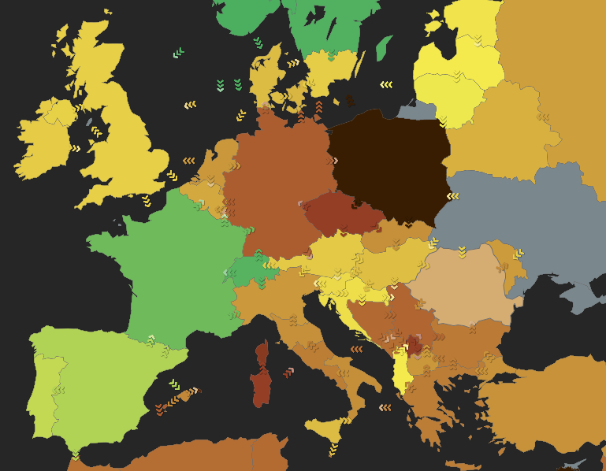

```{r}
#| include: false
# Quieten CodeCarbon before the first tracker is created, or knitting can
# hang at the first tracked chunk.
Sys.setenv(CODECARBON_LOG_LEVEL = "error")
```

## Description

TidyCarbon is an open source R package for measuring and comparing the
resource use of R programs. This is relevant because of the increased reliance of social science research on computationally complex machine learning and AI methods such as large language models [@balluff:2026:nlb], which may consume significantly more non-renewable resources than computationally less advanced methods [@hamiltonpalicki:2026:dlu; @luccioni:2024:phc].

TidyCarbon provides a tidy interface over the Python
libraries [CodeCarbon](https://codecarbon.io) [@courty:2026:codecarbon], for measuring the energy of
local programs, and [EcoLogits](https://ecologits.ai) [@rince:2025:ecologits], for estimating the
energy use of API calls to LLM providers. Based on measuring time, energy, location, and in, the case of API calls, the length of LLM responses, TidyCarbon provides estimates for equivalent carbon emissions, and water use needed to run the program. TidyCarbon does not implement its
own algorithms. Instead, it operates as a thin "shim" for integrating energy
and emissions estimates into R analysis workflows.

## Use Cases

- Track and report time, energy, carbon emissions, and water usage for
  computational analysis tasks.
- Track at macro and micro levels of a program: track a complete analysis, or
  insert TidyCarbon into a tidy pipeline to measure it step by step.
- Compare speed and energy use for alternative methods of analysis (e.g.
  different methods of sentiment analysis), providing data for reducing the
  computational effort and emissions of analyses.
- Estimate the energy use and emissions of LLM-based analyses on remote
  servers (OpenAI, Anthropic, Mistral) in real time or from chat transcripts.

## Important Functions

TidyCarbon provides functions to track time and energy, and to estimate
emissions, in a limited number of situations. To compare full R programs, the
`tracker_*` functions wrap existing R code you have already written. For more
fine-grained analyses and comparisons, the `carbon_*` functions operate at the
level of pipelines and individual R functions.

### Function List

| Function | Purpose |
|---|---|
| `carbon_init()` | Initialize a local tracker. May request access to local RAPL files to measure energy use directly, or estimates it from your machine's specs. See CodeCarbon for the methodology. |
| `carbon_init_remote()` | Initialize a remote tracker. Estimates emissions for requests made to LLM providers. See EcoLogits for the methodology. |
| `tracker_start()` | Begin tracking energy. Place before R pipelines. |
| `tracker_stop()` | End tracking energy. Place after R pipelines. |
| `carbon_track()` | Measure the energy of a single function call. |
| `carbon_step()` | Insert tracking into an R pipe, measuring the consumption of a single pipeline step. |
| `carbon_bench()` | Directly compare the emissions of functions. |
| `carbon_collect()` | View the results of the `carbon_step()` calls in a pipeline. |

## Output Data

Every measurement is returned as a tibble with one row per tracked task and
columns for the measurements and machine information. The most important
columns, with values from the first example below:

| Column | Unit | Example | Description |
|---|---|---|---|
| `label` | | `clean and count words` | Label given to the tracked task. |
| `wall_time_sec` | seconds | 0.90 | Elapsed time of the task. |
| `cpu_energy` | kWh | 0.0000094 | Energy used by the CPU. |
| `gpu_energy` | kWh | 0.0000046 | Energy used by the GPU. |
| `ram_energy` | kWh | 0.0000035 | Energy used by the RAM. |
| `energy_consumed` | kWh | 0.0000175 | Total energy: CPU, GPU and RAM. |
| `emissions_total` | kgCO2eq | 0.0000067 | Estimated emissions: energy times the carbon intensity of the grid. |
| `country_iso_code` | | `DEU` | Country used for the carbon intensity. |
| `cpu_model` | | `13th Gen Intel(R) Core(TM) i7-13700K` | CPU of the machine. |
| `gpu_model` | | `1 x NVIDIA GeForce RTX 3090 Ti` | GPU of the machine. |

As a side effect, results are automatically appended to a CSV file in a local
project folder. The examples under [How to Use](#how-to-use) show both.


# Requirements and Installation

TidyCarbon requires reticulate, which creates a Python environment that loads
the CodeCarbon and EcoLogits dependencies.

```{r}
#| eval: false
remotes::install_github("seankellyhp/tidycarbon")
library("tidycarbon")
```

TidyCarbon relies on tidyverse packages.

```{r}
#| eval: false
install.packages("tidyverse")
```

## How to Use

### Initialize local tracking

The following examples demonstrate tracking the resources needed for
computation on a local system. Importantly, measurements are made at the level
of the machine. For accurate comparisons, ensure that no other compute- or
memory-intensive programs (e.g. browsers, long-running analysis tasks) are
running.

```{r}
#| eval: false
Sys.setenv(CODECARBON_LOG_LEVEL = "error")

carbon_init(
  project_name     = "Hello_World",
  output_dir       = file.path(tempdir(), "tidycarbon_results"),
  offline          = TRUE,
  country_iso_code = "DEU"
)
```

This starts CodeCarbon in the background. The first install may take a few
minutes while the Python environment is set up.

The first line quietens CodeCarbon, which otherwise prints a progress line for
every reading. Keep it when you knit a document: with the progress lines on,
knitting can hang at the first tracked chunk.

The project will be called `Hello_World` in the rows of the resulting tibble.
A CSV of results will be saved to `tidycarbon_results/emissions_r.csv`.
Results are always appended to this file, so it is the source of truth for
all tracking done in the project.

By default CodeCarbon looks up the country the machine is in, with one request
to a geolocation service, to estimate the carbon intensity of its electricity.
`offline = TRUE` with `country_iso_code` skips that request.

Carbon intensity is the relationship between energy and the estimated amount
of carbon emitted to generate that electricity. It depends on the
sustainability of local power grids and varies greatly, as Figure 1 shows.
Countries such as France have a low carbon intensity because they generate a
higher proportion of their electricity from low-carbon sources (nuclear,
solar). In contrast, Germany and the US generate a higher proportion from
fossil fuels (coal, gas). 

```{r}
#| label: electricity-map
#| echo: false
#| out-width: "80%"
#| fig-align: center
#| fig-cap: "Figure 1. Carbon intensity of electricity across Europe. Green is low, yellow to brown is higher, and grey has no data. Source: Electricity Maps."

```

### Basic measurements of an R program

We will demonstrate a standard text analysis, using examples from the
[Tidy Text Mining](https://www.tidytextmining.com) book [@silge:2017:tmr].

#### Load packages and data

We load the Austen books dataset and several tidyverse packages.

```{r}
library(tidycarbon)

# tidyverse packages
library(dplyr)
library(tidyr)
library(stringr)
library(ggplot2)
library(tidytext)
library(janeaustenr)
library(purrr)

# more advanced analyses downstream
library(topicmodels)
library(quanteda)
library(quanteda.sentiment)
```

```{r}
#| results: hide
carbon_init(
  project_name     = "Austen_tutorial",
  output_dir       = file.path(tempdir(), "tidycarbon_results"),
  offline          = TRUE,
  country_iso_code = "DEU"
)
```

For the first example, we start the tracker before a pipeline that counts the
top words in Austen's novels, and stop it afterwards. It is as simple as
placing the tracker before and after existing R code.

#### Tracker start and stop

```{r}
tracker_start() # Start tracker

books <- austen_books() |>
  group_by(book) |>
  mutate(
    linenumber = row_number(),
    chapter = cumsum(str_detect(
      text,
      regex("^chapter [\\divxlc]", ignore_case = TRUE)
    ))
  ) |>
  ungroup()

books |>
  unnest_tokens(word, text) |>
  anti_join(stop_words, by = "word") |>
  count(book, word, sort = TRUE)

books_emit <- tracker_stop(label = "clean and count words") # End tracker
```

The object `books_emit` is now a one-row tibble of the carbon measurement. It
has all of the columns returned by CodeCarbon, most of which are not needed
for downstream analysis. It can be cleaned up like any other tibble.

```{r}
emissions <- books_emit |>
  select(label, wall_time_sec, cpu_energy, gpu_energy, ram_energy,
         energy_consumed, emissions_total)

emissions
```

The results include estimates of time, hardware-level energy consumption,
aggregated energy consumption and an estimate of emissions. `wall_time_sec`
is in seconds, `energy_consumed` in kWh and `emissions_total` in kgCO2eq. For
a task this small, the time and energy needs are very small, so watt-hours and
milligrams are easier to read:

```{r}
emissions |>
  transmute(
    cpu_wh   = cpu_energy * 1000,
    gpu_wh   = gpu_energy * 1000,
    ram_wh   = ram_energy * 1000,
    total_wh = energy_consumed * 1000,
    co2e_mg  = emissions_total * 1e6
  )
```

This level of analysis is useful for reporting and requires the least effort.
Reporting is a very important part of understanding the environmental impacts
of computational methods. However, as this example shows, emissions tracking
is less meaningful for relatively "simple" computational methods such as basic
transformations of data and counting tasks.

Efficiency becomes more relevant with big data, machine learning and AI.
Computational costs are related to the time and memory needed to complete a
task. Tasks that are more computationally complex consume more resources.

### Tracking the efficiency of specific tasks

Now we will take the same data and do a more complex analysis. Counting and
joining are cheap. Fitting a model is not. This stage treats each chapter as a
document and asks latent Dirichlet allocation for six topics, one per novel.
We are interested in the computational needs of fitting a topic model, not
the topics themselves.

`LDA()` needs a document-term matrix, so the pipeline is: label the chapters,
tokenize, drop stop words, count words per chapter, cast to a matrix, fit. To
see what each step in this pipeline costs, wrap each one in `carbon_step()`.
Each `carbon_step()` takes an optional label describing the task.

```{r}
label_chapters <- function(data) {
  data |>
    filter(chapter > 0) |>
    unite(document, book, chapter)
}

lda <- books |>
  carbon_step(label_chapters(), label = "label chapters") |>
  carbon_step(unnest_tokens(word, text), label = "tokenize chapters") |>
  carbon_step(
    anti_join(stop_words, by = "word"),
    label = "remove stop words"
  ) |>
  carbon_step(count(document, word), label = "count by chapter") |>
  carbon_step(cast_dtm(document, word, n), label = "cast to dtm") |>
  carbon_step(LDA(k = 6, control = list(seed = 1234)), label = "LDA")

lda
```

`lda` is the fitted model, exactly as the plain pipeline would return it. The
carbon measurements are now carried along with the model. Use
`carbon_collect()` to see them, one row per step.

```{r}
lda_steps <- carbon_collect(lda)

lda_steps |>
  transmute(
    label,
    wall_time_sec,
    energy_wh = energy_consumed * 1000,
    share     = energy_consumed / sum(energy_consumed)
  )
```

Preparing the text is a small fraction of the total. Almost all of the energy
goes into fitting the model:

```{r}
#| label: lda-plot
#| fig-width: 7
#| fig-height: 3.5
lda_steps |>
  mutate(label = factor(label, levels = rev(label))) |>
  ggplot(aes(energy_consumed * 1000, label)) +
  geom_col() +
  labs(x = "Energy (Wh)", y = NULL)
```

When an LDA is fit on larger data, with more topics, or with more fits to find
the optimal number of topics (k), these numbers increase. Yet they are hardly
noticeable compared to ever more complex fine-tuning of transformer models or
inference with large language models.

### Sentiment analysis at increasing levels of complexity

Next we will use two approaches for sentiment analysis, with a focus on
comparing their emissions. We will start with the least complex approach,
dictionaries, and then estimate inference for a large language model called
via an API.

#### The sentences

Sentiment is scored sentence by sentence, for every sentence of
*Pride and Prejudice*. The data has one row per printed line, and a line is rarely a sentence.
`unnest_sentences()` splits text into sentences, so first join each chapter's
lines back into one string. The titles in front of names are written without
their full stop, or every "Mrs." would end a sentence:

```{r}
chapters <- books |>
  filter(
    book == "Pride & Prejudice",
    chapter > 0,
    !str_detect(text, regex("^chapter [\\divxlc]", ignore_case = TRUE))
  ) |>
  group_by(chapter) |>
  summarise(text = str_squish(str_c(text, collapse = " "))) |>
  mutate(text = str_replace_all(text, "\\b(Mr|Mrs|Dr)\\.", "\\1"))

pride <- chapters |>
  unnest_sentences(sentence, text, to_lower = FALSE) |>
  mutate(id = row_number()) |>
  select(id, chapter, sentence)

pride
```

#### Dictionary sentiment

The least complex approach is a dictionary: split each sentence into words,
join the bing lexicon, and count positive against negative words. A sentence
with no lexicon word, or as many positive as negative ones, is neutral.

`carbon_track()` calls a function with its arguments and returns one row: the
measurement, with the function's value in the `result` column. Here it scores
every sentence in the novel:

```{r}
score_with_dictionary <- function(data) {
  data |>
    unnest_tokens(word, sentence) |>
    inner_join(
      get_sentiments("bing"),
      by = "word",
      relationship = "many-to-many"
    ) |>
    count(id, wt = if_else(sentiment == "positive", 1, -1), name = "score") |>
    right_join(select(data, id), by = "id") |>
    arrange(id) |>
    transmute(id, sentiment = case_when(
      is.na(score) | score == 0 ~ "neutral",
      score > 0 ~ "positive",
      score < 0 ~ "negative"
    ))
}

dict <- carbon_track(
  score_with_dictionary, pride,
  label = "dictionary sentiment"
)

dict |>
  transmute(label, wall_time_sec, energy_wh = energy_consumed * 1000,
            co2e_mg = emissions_total * 1e6)
```

Labelling all `r format(nrow(pride), big.mark = ",")` sentences takes a
fraction of a second. The labels are in `result`:

```{r}
dictionary_labels <- dict$result[[1]]

dictionary_labels |>
  count(sentiment)
```

#### Benchmark: tidytext or quanteda?

The same dictionary approach can be written with
[quanteda.sentiment](https://github.com/quanteda/quanteda.sentiment), which
includes the same lexicon as bing (`data_dictionary_HuLiu`). It is installed
from GitHub:

```{r}
#| eval: false
remotes::install_github("quanteda/quanteda.sentiment")
```

To compare the two packages fairly, both start from the same texts, the
`chapters` of *Pride and Prejudice*, one row per chapter. Each one then
splits the chapters into sentences, tokenizes them and scores every sentence,
and the sign of the score gives the label. Every step is part of what is
measured:

```{r}
sentiment_tidytext <- function(texts) {
  texts |>
    unnest_sentences(sentence, text, to_lower = FALSE) |>
    mutate(id = row_number()) |>
    score_with_dictionary()
}

score_with_quanteda <- function(sentences) {
  sentences |>
    tokens() |>
    textstat_polarity(dictionary = data_dictionary_HuLiu) |>
    transmute(id = row_number(), sentiment = case_when(
      sentiment > 0 ~ "positive",
      sentiment < 0 ~ "negative",
      .default = "neutral"
    ))
}

sentiment_quanteda <- function(texts) {
  texts |>
    corpus(text_field = "text") |>
    corpus_reshape(to = "sentences") |>
    score_with_quanteda()
}
```

The two packages split sentences slightly differently, so to compare their
labels, score the same sentences, `pride`, with both. The confusion matrix
shows where they agree:

```{r}
quanteda_labels <- pride |>
  corpus(text_field = "sentence") |>
  score_with_quanteda()

table(
  tidytext = dictionary_labels$sentiment,
  quanteda = quanteda_labels$sentiment
)
```

`carbon_bench()` runs each approach repeatedly, in random order, and measures
every run:

```{r}
bench <- carbon_bench(
  tidytext = sentiment_tidytext(chapters),
  quanteda = sentiment_quanteda(chapters),
  times = 20
)

bench |>
  group_by(expr) |>
  summarise(
    duration_sec = median(duration),
    energy_wh    = median(energy_consumed) * 1000,
    co2e_mg      = median(emissions_total) * 1e6
  )
```

```{r}
#| label: bench-plot
#| fig-width: 7
#| fig-height: 3.5
autoplot(bench, metric = "energy_consumed")
```

#### Language model sentiment

The language model runs in a provider's data center, reached through
[OpenRouter](https://openrouter.ai) with
[ellmer](https://ellmer.tidyverse.org) [@wickham:2025:ellmer]. It needs an API
key. Put the key in a `.env` file, with no spaces around the `=`, and keep
that file out of version control:

```
OPENROUTER_API_KEY=sk-or-...
```

The work happens in the provider's data center, where the tracker from
`carbon_init()` cannot see it. `carbon_init_remote()` creates a tracker for
the provider instead: give it the chat, then pass it as `tracker`. The
estimate comes from [EcoLogits](https://ecologits.ai), which is installed
automatically through reticulate.

The code below is not run when the tutorial is rendered, because it needs an
API key and every request costs money. Check the price of the model on
OpenRouter before you run it.

```{r}
#| eval: false
library(ellmer)
readRenviron(".env")

chat <- chat_openrouter(
  model = "openai/gpt-6-luna",
  system_prompt = "You classify the sentiment of sentences from a novel.",
  echo = "none"
)

remote <- carbon_init_remote(
  chat,
  project_name = "Austen_tutorial",
  output_dir   = file.path(tempdir(), "tidycarbon_results")
)

# Number the sentences, so all of them go in a single prompt.
sentiment_type <- type_array(items = type_object(
  id        = type_integer("Number of the sentence"),
  sentiment = type_enum(values = c("positive", "neutral", "negative"))
))

classify <- function(sentences, chat) {
  prompt <- paste0(sentences$id, ". ", sentences$sentence, collapse = "\n")
  chat$chat_structured(prompt, type = sentiment_type)
}

# A random sample of 200 sentences keeps the request short and cheap.
set.seed(1234)
pride_sample <- slice_sample(pride, n = 200)

llm <- carbon_track(
  classify, pride_sample, chat,
  tracker = remote,
  label   = "LLM sentiment"
)

llm_labels <- llm$result[[1]]

llm |>
  transmute(
    label,
    wall_time_sec,
    n_modelled,
    output_tokens,
    energy_wh = energy_consumed_mean * 1000,
    co2e_mg   = emissions_total_mean * 1e6,
    water_ml  = water_consumed_mean * 1000
  )
```

Each impact column comes as a lower bound, a mean and an upper bound: the
provider does not publish the size of its models, so EcoLogits brackets it. A
remote tracker also estimates water, both what cools the data center and what
generating its electricity consumes. Check `n_modelled` first: if it is 0,
EcoLogits does not know the model and the impact columns are `NA`.

Remote measurements are logged to their own file, `emissions_remote.csv`,
because their columns differ from a local measurement.

#### Dictionary or model?

Read the gaps as orders of magnitude, not as precise ratios. The dictionary
figure is your whole machine, measured over a fraction of a second, which is
too short to measure well. The remote figure is an estimate of the
provider's data center, with a wider scope, and should not be added to the
local ones. The direction is the useful part: if a dictionary answers the
question, it does so for a small fraction of the emissions [@balluff:2026:nlb]; if it does not,
the number of sentences sent to a model is what sets the bill.

## Technical Details

Visit the [GitHub repository](https://github.com/seankellyhp/tidycarbon) for
the technical implementation.

## References

::: {#refs}
:::

## Disclaimer

This method is intended for academic research; ensure legality and ethics
when processing chat data.

## Contact Details
